# Wazuh SOC Home Lab: Threat Detection and Attack Simulation

A small SOC lab built on VirtualBox: a Wazuh SIEM/XDR server, a Windows 10 endpoint with Sysmon, custom detection rules mapped to MITRE ATT&CK, and three Atomic Red Team simulations that I triggered myself and watched Wazuh detect.

## Summary

| Item | Value |
|---|---|
| Wazuh version | 4.9.2 (indexer, manager, dashboard on one VM) |
| Endpoint | Windows 10 (build 19045) with Sysmon64 and Wazuh agent 4.9.2 |
| Manager OS | Ubuntu Server 22.04.5 |
| Telemetry | Sysmon (process creation, registry events) + Windows event channels |
| Custom rules | 2 (`100100`, `100101`) |
| Techniques tested | T1059.001, T1547.001, T1003 (Atomic Red Team test T1003-7) |
| Detections | 3 of 3 techniques alerted; 2 of 3 needed my own rule or tuning |
| Not included | Part 2 extras (Suricata, YARA/ClamAV, osquery, Caldera) |

## Architecture

```
 Windows 10 VM                         Ubuntu Server VM
 Sysmon + Wazuh agent  --1514/TCP-->   Wazuh manager + indexer + dashboard
 (Atomic Red Team tests)               (custom rules in local_rules.xml)
          \_____ VirtualBox host-only network _____/
```

Both VMs sit on a host-only network, and nothing is exposed to the internet.

## 1. Setup: agent connected and Sysmon telemetry flowing

The Wazuh agent on the Windows VM reports to the manager and shows as **active**.

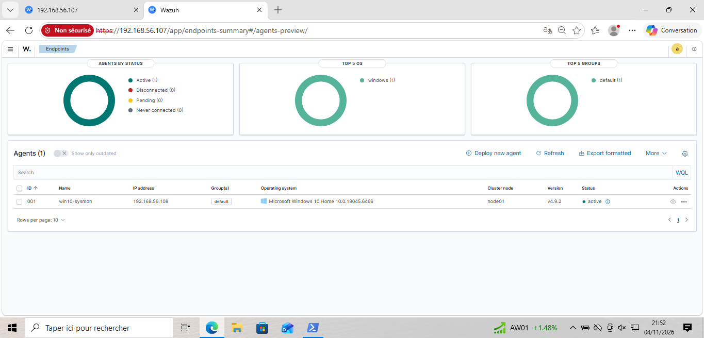

After adding the `Microsoft-Windows-Sysmon/Operational` channel to the agent config, Sysmon events arrive in Threat Hunting (28 hits in the first window).

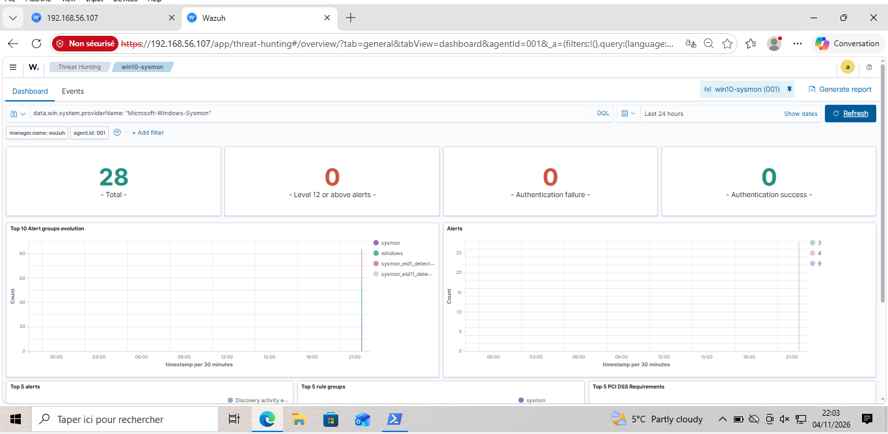

Wazuh's default ruleset already fires on that telemetry (discovery commands, PowerShell dropping executables).

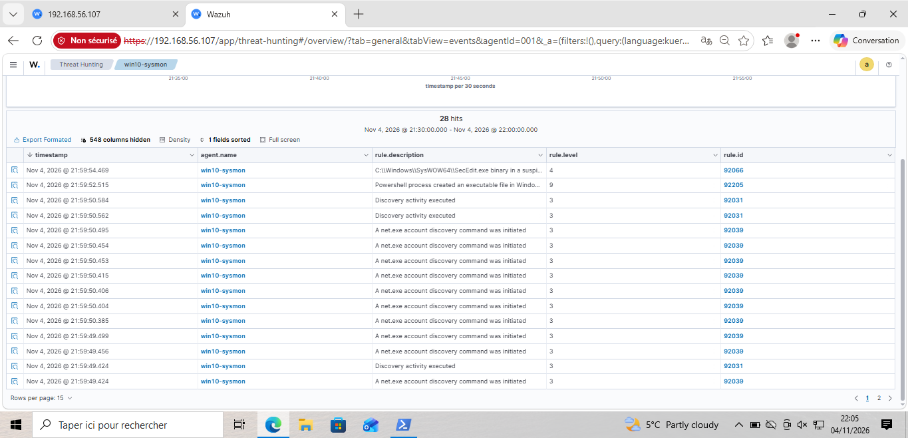

## 2. Simulation 1: PowerShell encoded commands (T1059.001)

**Version 0 (no alert).** My first rule hooked into `sysmon_event1`. A manual encoded command produced no `100100` alert, because Wazuh's built-in rule 92057 (level 12) matched the same event first, and only one rule wins per event.

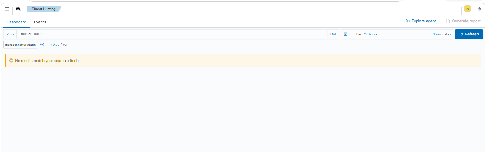

**Version 1.** I rebuilt it as a child of 92057 at level 13, and the same manual encoded command (`powershell.exe -EncodedCommand ...`) fired it.

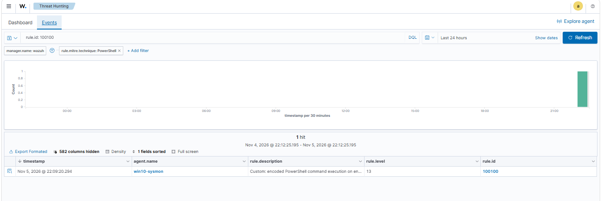

The alert carries the MITRE mapping (T1059.001, tactic Execution, technique PowerShell).

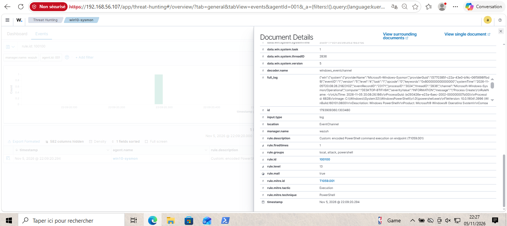

**Atomic Red Team test 15** runs PowerShell with three spellings of the encoded-command switch: `-E`, `-EncodedCommand` and `-Enc`.

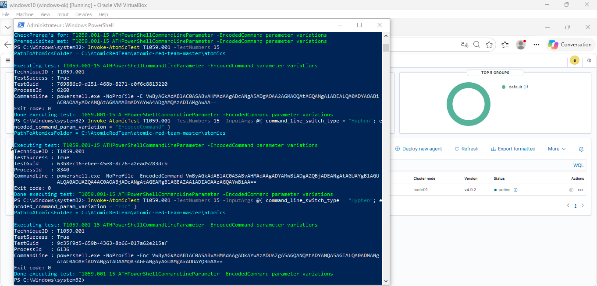

**Finding: version 1 missed all three.** Atomic Red Team starts PowerShell through WMI, so the events follow a different rule chain. Wazuh's built-in rule `92071` (level 12) alerted instead, and my custom rule never ran.

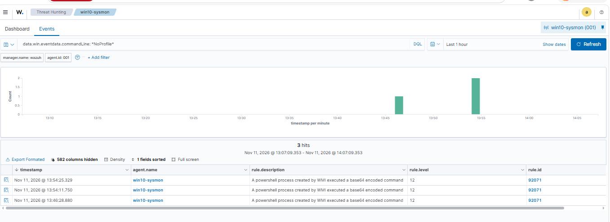

The default rule's own pattern shows why it handled every spelling: it matches `powershell.exe` followed by `-e` or its longer forms (`-ea`, `-ec`, `-en`, `-enco`, `-encode`, `-encodeda`, `-encodedcommand`).

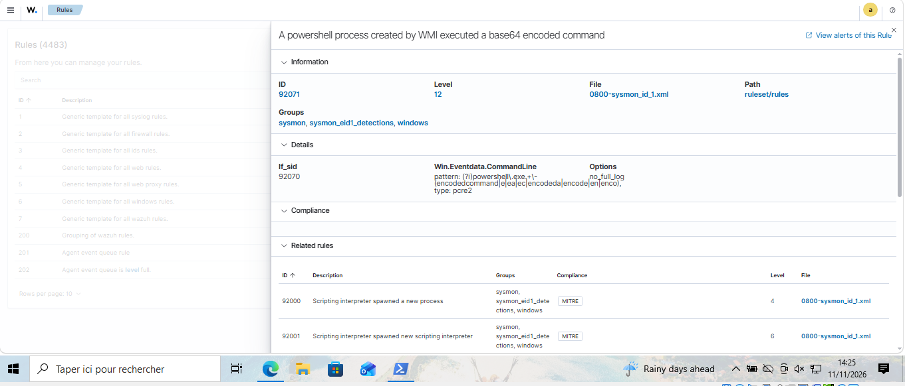

**Fix (version 2).** The rule now hooks into both parent rules (`if_sid` 92057 and 92071) and its regex covers the abbreviated switches followed by a base64-looking payload.

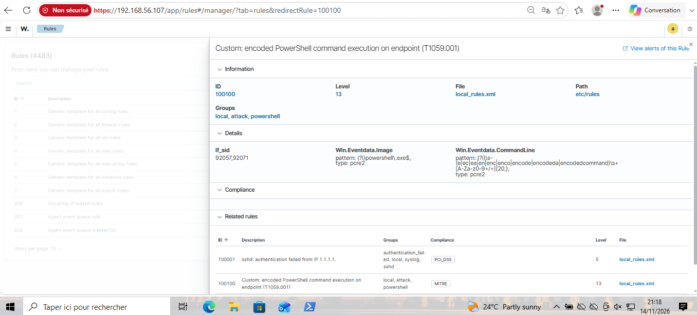

**Result.** Re-running the test produced six alerts from rule `100100` at level 13 (two runs of the three variants).

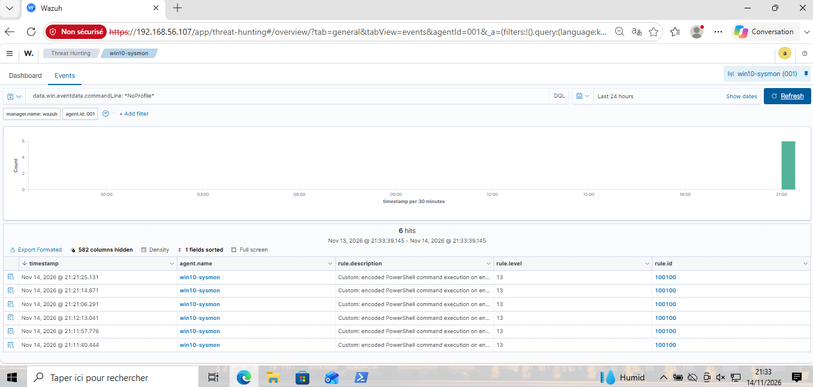

## 3. Simulation 2: Registry Run key persistence (T1547.001)

Atomic test 1 (`Reg Key Run`) adds a value to `HKCU\...\CurrentVersion\Run` with `reg.exe`, then it is cleaned up with the test's cleanup command.

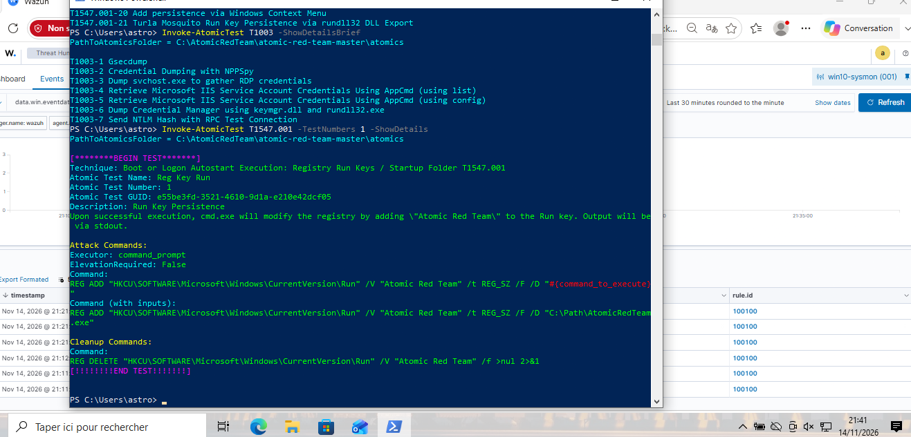

Running it adds the value `Atomic Red Team` to the Run key, and the cleanup command removes it again.

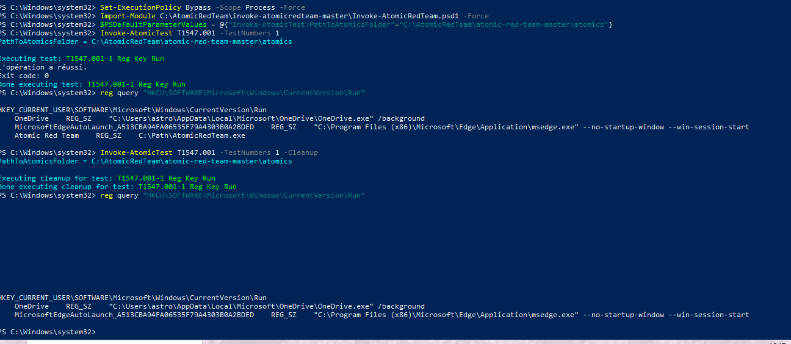

Wazuh's default rules caught it with no custom rule: `92302` (registry entry executed on next logon modified by `reg.exe`, level 6), `92041` (Base64-like value added to a registry key, level 10) and `92052` (command prompt started by an abnormal process, level 4).

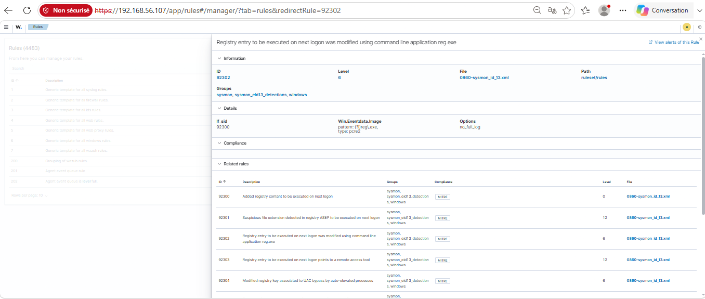

The three alerts appear in Threat Hunting right after the run (16:15:57 in this screenshot, from a re-run on Nov 17; the original run on Nov 14 produced the same three alerts).

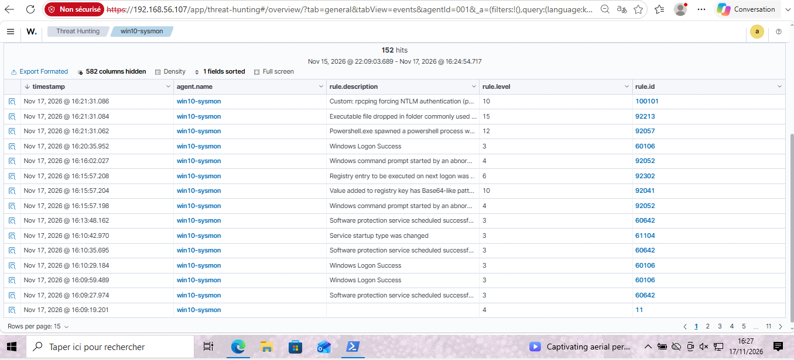

## 4. Simulation 3: NTLM authentication forced with rpcping (T1003)

Atomic test T1003-7 runs `rpcping -s 127.0.0.1 -e 1234 -a privacy -u NTLM` against localhost only; nothing is dumped or downloaded.

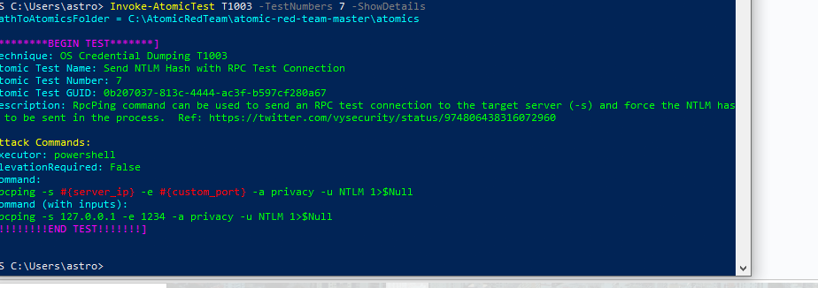

**Finding: Sysmon logged the process, but Wazuh created no alert.** No default rule matches `rpcping` with NTLM options. Each run produces two Sysmon process-creation events (ID 1): the PowerShell wrapper that launches the command, and `RpcPing.exe` itself with `-u NTLM` (screenshot from the Nov 17 re-run).

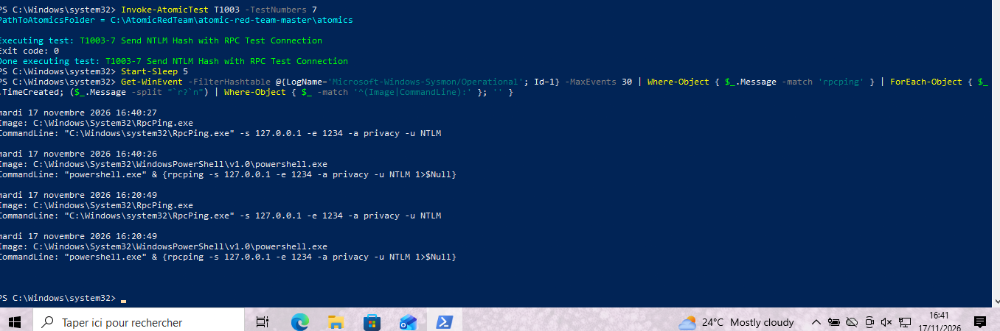

**Fix.** Custom rule `100101` (level 10) matches `rpcping.exe` with `-u NTLM`.

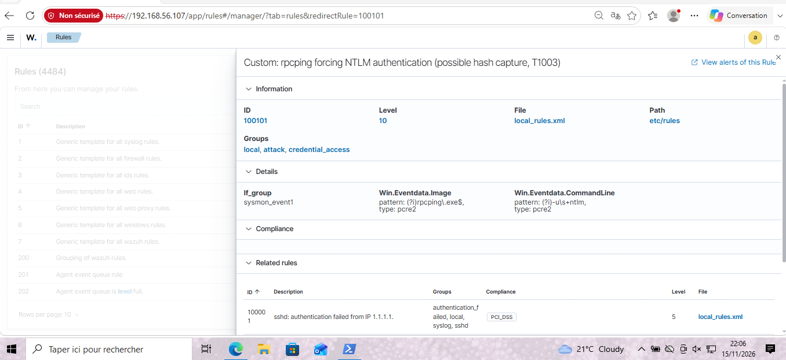

After the rule was loaded, the test alerted at level 10 (first on Nov 15, then again on a Nov 17 re-run). In the table below, the `100101` row at 16:21:31 sits next to `92057` and `92213`, which come from the PowerShell session that launched the test.


## Results

| # | Technique | Atomic test | Default Wazuh detection | Result |
|---|---|---|---|---|
| 1 | T1059.001 PowerShell | T1059.001-15 (EncodedCommand variants) | Rule 92071, level 12 | Custom rule 100100 needed two fixes (shadowed by a default rule, then missed the WMI launch path); then 6/6 alerts at level 13 |
| 2 | T1547.001 Run key persistence | T1547.001-1 | Rules 92302 (level 6), 92041 (level 10), 92052 (level 4) | Detected by default rules |
| 3 | T1003 NTLM forced with rpcping | T1003-7 | None (Sysmon logged it, Wazuh did not alert) | Gap closed with custom rule 100101, level 10 |

Full write-ups with alert details: [`simulations/atomic-tests-log.md`](/atomic-tests-log.md).
Custom rules: [`rules/local_rules.xml`](/local_rules.xml).

## What I learned

- **Only one rule wins per event.** My first PowerShell rule never fired because a built-in rule matched the same event first. When a custom rule stays silent, check which rule actually fired before assuming the rule is broken.
- **A custom rule that hangs off one parent rule only sees what that parent sees.** Version 1 worked for a manual test but missed Atomic Red Team, which starts PowerShell through WMI. Testing several launch methods exposed the gap.
- **Default rules are strong on well-known behaviour** (encoded PowerShell, Run key writes) and silent on niche tools (`rpcping` with NTLM). Sysmon having the event is not the same as Wazuh alerting on it.
- **Operations matter.** The Wazuh manager's vulnerability-detection updater filled a 40 GB disk with temporary downloads (about 21 GB in `/var/ossec/queue/vd_updater/tmp`), which crashed the indexer and manager. I cleaned the temp folder, disabled vulnerability detection for this lab, and added a longer service start timeout.
- Wazuh leaves a stale lock (`/var/ossec/var/start-script-lock`) after an unclean shutdown. Shut VMs down cleanly.

## Reproduce it

1. Create an Ubuntu Server 22.04 VM (4 GB RAM or more, 40 GB disk) and install Wazuh with the official all-in-one installer (`wazuh-install.sh -a`).
2. Install the Wazuh agent on the Windows VM and add the Sysmon `localfile` block
